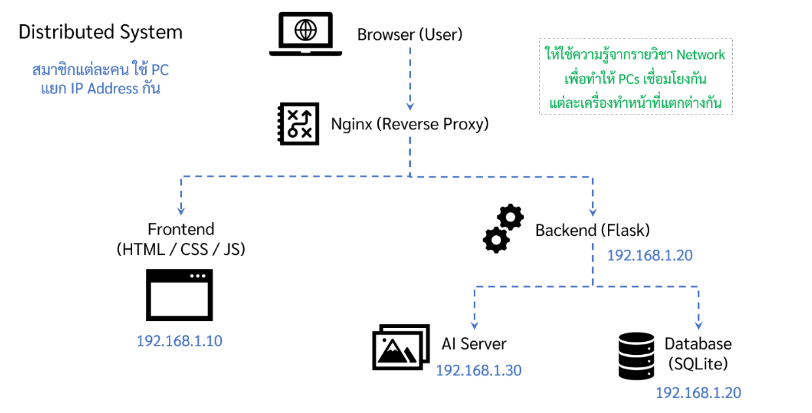
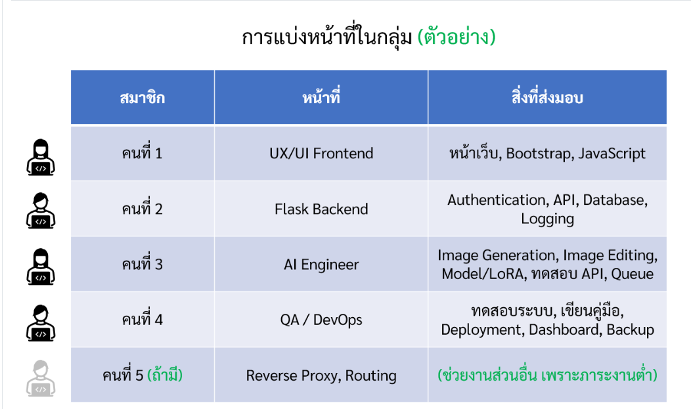
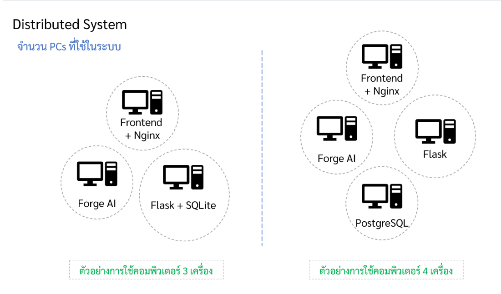

# Project LUMA

LUMA เป็นเว็บแอปสร้างและแก้ไขภาพ จัดการบัญชี งาน และรายการโปรด ผ่าน Flask Backend และ FastAPI AI Engine

ปรับปรุงวันที่ 14 ตุลาคม 2026 อ้างอิง `main` ที่ `5b52b9e` ซึ่งรวม PR #2 และการแก้ไขความปลอดภัย session การตรวจสอบข้อมูล และการเปิดบริการล่าสุดแล้ว

## ความสามารถและสถาปัตยกรรม

Browser → Frontend/Nginx → Flask Backend → FastAPI AI Engine → Forge

| บริการ | หน้าที่ | พอร์ตทั่วไป |
| --- | --- | --- |
| Frontend/Nginx | หน้าเว็บและ same-origin proxy | 80; static development 8080 |
| Backend | JWT ผู้ใช้ งาน SQLite และไฟล์ส่วนตัว | 5000 |
| AI Engine | ตรวจสอบคำขอ คิว และ provider | 8000 |
| Forge | ประมวลผลโมเดลบนเครื่อง AI | 7860 |

- สร้าง/แก้ไขภาพ เลือกโมเดลและ LoRA ใช้ trigger words, tags, PNG metadata, filters และ upscaling ตาม provider
- ติดตามงานทุกประมาณ 1 วินาที ยกเลิกงานของตนเอง และเพิ่ม/ค้นหา/แก้ไข/ลบรายการโปรด
- แยกงานและผลลัพธ์ตามผู้ใช้ ป้องกันคำตอบจาก session เก่า และล้างข้อมูลส่วนตัวเมื่อออกจากระบบ
- ตรวจสอบตัวเลือก จำกัดขนาดและการประมวลผลภาพ และติดตามงานต่อเมื่อบริการขัดข้องชั่วคราว
- เก็บ Bootstrap 5.3.3 ใน repository เพื่อให้หน้าเข้าสู่ระบบทำงานได้เมื่อเข้าถึง CDN ไม่ได้
- รองรับ signed media URLs, backup/restore และ startup recovery

`development-procedural` ใช้ Pillow และ CPU สำหรับทดสอบระบบ ไม่ใช่โมเดลสร้างภาพที่ผ่านการฝึก Backend ใช้คิวใน process จึงควรเปิดหนึ่ง process จนกว่าจะใช้ shared queue ส่วน Forge ถูกจำกัดให้ทำงานทีละงาน เพราะ progress/interrupt ใช้สถานะร่วมกัน หลีกเลี่ยงการสร้างภาพผ่านหน้า Forge พร้อมกับ LUMA

## Infrastructure: ระบบ Distributed System แบบ 3 PCs

โครงการนี้ใช้ **คอมพิวเตอร์ 3 เครื่อง** ตามแผนภาพต้นฉบับ แต่ละเครื่องมี IP Address แยกกันและเชื่อมต่อผ่านเครือข่าย LAN/VLAN ที่สื่อสารถึงกันได้ Frontend กับ Nginx อยู่เครื่องเดียวกัน และ Flask กับ SQLite อยู่เครื่องเดียวกัน IP ด้านล่างตรงกับแผนภาพและไฟล์ VLAN example; ตรวจ IP จริงก่อนเปิดบริการ ไม่ใช่หลักฐานว่าทดสอบเครือข่ายจริงแล้ว



*ภาพที่ 1: Browser เข้า Nginx แล้วเรียก Frontend/Flask; Flask ติดต่อ AI Server และ SQLite*

### เครื่อง บริการ และ IP Address

| เครื่องตาม deployment ปัจจุบัน | IP ตามแผนภาพ | บริการและข้อมูล |
| --- | --- | --- |
| PC 2 — Frontend + Nginx | `192.168.1.10` | HTML, CSS, JavaScript, Bootstrap และ reverse proxy; Browser เข้า `http://192.168.1.10` |
| PC 3 — Flask + SQLite | `192.168.1.20` | Flask API port `5000`, authentication, jobs, logging, database และไฟล์ภาพ |
| PC 1 — AI Server | `192.168.1.30` | FastAPI port `8000` และ Forge บนเครื่องเดียวกันที่ `127.0.0.1:7860` |

หมายเลข PC ใช้ตามคู่มือ deployment ใน repository ไม่ใช่หมายเลขสมาชิกในตารางแบ่งหน้าที่

### ข้อมูลและ protocol ที่ใช้

แผนภาพระบุองค์ประกอบและ IP ส่วน ports/protocol ด้านล่างอ้างอิง configuration ที่ใช้อยู่ (`nginx/luma.conf` และไฟล์ `.env.vlan.example`):

| การเชื่อมต่อ | Protocol / ข้อมูล | รายละเอียด |
| --- | --- | --- |
| Browser → Nginx `.10:80` | HTTP บน TCP; HTML/CSS/JS, JSON และไฟล์ภาพ | Nginx ส่งหน้าเว็บและไฟล์ static; browser ใช้ origin เดียวกัน |
| Nginx → Flask `.20:5000` | HTTP reverse proxy | ส่ง `/api/` และ `/media/` ไป Flask พร้อม forwarded headers; user authentication ใช้ JWT |
| Flask → FastAPI `.30:8000` | HTTP API; JSON/ข้อมูลภาพตาม endpoint | ใช้ `X-LUMA-Service-Token` และ `X-LUMA-Job-ID` เพื่อเชื่อมบริการและระบุงาน |
| FastAPI → Forge `127.0.0.1:7860` | HTTP API; JSON และภาพ Base64 ตาม Forge contract | ใช้ `/sdapi/v1/txt2img` และ `/sdapi/v1/img2img`; Forge อยู่ภายใน PC 1 |
| Flask → SQLite บน `.20` | การอ่าน/เขียนไฟล์ผ่าน SQLite/SQLAlchemy | ฐานข้อมูลเริ่มต้น `backend/data/luma.db`; ไม่มี database TCP port หรือ SQLite server แยก |

Configuration VLAN ปัจจุบันเป็น HTTP ไม่ได้ตั้ง HTTPS/TLS ในไฟล์ตัวอย่าง SQLite ที่แสดง IP `.20` ในภาพหมายถึงฐานข้อมูลอยู่บนเครื่อง Backend ไม่ใช่บริการฐานข้อมูลที่เปิดให้เครื่องอื่นเชื่อมต่อโดยตรง

### ขั้นตอนการทำงาน

1. ผู้ใช้เปิด `http://192.168.1.10` ผ่าน Browser; Nginx ส่ง Frontend ให้แสดงหน้าเว็บ
2. ผู้ใช้ลงทะเบียน/เข้าสู่ระบบ Frontend ส่ง API ผ่าน Nginx ไป Flask ซึ่งตรวจข้อมูลกับ SQLite และออก JWT
3. ผู้ใช้ส่ง prompt หรือภาพสำหรับแก้ไข Flask ตรวจสิทธิ์และข้อมูล สร้าง job แล้วตอบ HTTP 202 พร้อมข้อมูลติดตามงาน
4. Flask เรียก FastAPI ที่ `192.168.1.30:8000`; FastAPI จัดคิวและเรียก Forge ภายในเครื่อง AI
5. Frontend ติดตามสถานะงานผ่าน Nginx/Flask ทุกประมาณ 1 วินาที โดยตรวจเจ้าของงานก่อนคืนข้อมูล
6. เมื่อได้ผล Flask จัดเก็บไฟล์ภาพและบันทึกข้อมูลใน SQLite; Browser เรียกภาพผ่าน `/media/` ซึ่ง Flask ตรวจ JWT หรือ signed URL ก่อนส่งภาพ
7. Favorites, history และการยกเลิกงานใช้ Backend ตรวจเจ้าของข้อมูลเช่นเดียวกัน Browser ไม่ติดต่อ Forge หรือ SQLite โดยตรง

### ตั้งค่าให้ตรงกับแผนภาพ

- PC 2: `nginx/luma.conf` ใช้ `server_name 192.168.1.10` และ upstream `192.168.1.20:5000`; แก้ frontend root ให้ตรงกับ path จริง
- PC 3: `backend/.env.vlan.example` กำหนด `AI_SERVICE_URL=http://192.168.1.30:8000` และ `CORS_ORIGINS=http://192.168.1.10`
- PC 1: `ai-engine/.env.vlan.example` กำหนด port `8000`, `AI_PROVIDER=forge` และ `FORGE_URL=http://127.0.0.1:7860`
- ตั้ง shared service token ให้ตรงกันบน PC 1/PC 3 และเปลี่ยน signing secrets ของ Backend เปิด firewall ให้ Nginx ติดต่อ Backend และ Backend ติดต่อ AI ได้ โดยไม่จำเป็นต้องเปิด Forge ให้ทุกเครื่อง

### การแบ่งหน้าที่ในทีม



*ภาพที่ 2: ตัวอย่างบทบาทสมาชิก ไม่ใช่การระบุชื่อผู้รับผิดชอบจริง*

| บทบาทตามแผนภาพ | สิ่งที่ส่งมอบ | Branch ที่เกี่ยวข้อง |
| --- | --- | --- |
| UX/UI Frontend | หน้าเว็บ, Bootstrap, JavaScript | `Frontend` |
| Flask Backend | Authentication, API, Database, Logging | `Backend` |
| AI Engineer | Image Generation/Editing, Model/LoRA, API tests, Queue | `AiEngine` |
| QA / DevOps | ทดสอบระบบ, คู่มือ, Deployment, Dashboard, Backup | `QA` |
| Reverse Proxy / Routing | Nginx, การส่งต่อคำขอและการเชื่อมเครือข่าย; ช่วยส่วนอื่นตามความเหมาะสม | `Routing` |

บทบาทเหล่านี้เป็นการแบ่งงานพัฒนา ไม่ได้หมายความว่าต้องใช้คอมพิวเตอร์หนึ่งเครื่องต่อสมาชิกหนึ่งคน



*ภาพที่ 3: โครงการนี้ใช้รูปฝั่งซ้าย — 3 เครื่องและ SQLite อยู่กับ Flask ส่วนรูปฝั่งขวาเป็นตัวอย่างทางเลือก 4 เครื่องที่แยก PostgreSQL ซึ่งไม่ได้ใช้ใน deployment นี้*

ดูขั้นตอนตรวจเครือข่ายและเปิดบริการใน [คู่มือระบบ 3 เครื่อง](docs/PROJECTLUMA_3PC_TEST_GUIDE.md)

## เริ่มใช้งานบน Windows

ต้องมี Python; Node.js ใช้ตรวจ frontend และ Docker ใช้กับ Compose CI ใช้ Python 3.12 และ Node.js 22

จาก root สร้างไฟล์ตั้งค่าเฉพาะเมื่อยังไม่มี:

```powershell
if (-not (Test-Path backend/.env)) { Copy-Item backend/.env.example backend/.env }
if (-not (Test-Path ai-engine/.env)) { Copy-Item ai-engine/.env.example ai-engine/.env }
```

ก่อนเปิดบริการ ตั้ง `AI_SERVICE_TOKEN` เป็นค่าสุ่มเดียวกันทั้งสองบริการ และตั้ง Backend `SECRET_KEY` / `JWT_SECRET_KEY` เป็นค่าสุ่มแยกกันอย่างน้อย 32 ตัวอักษร ค่า example ถูกปฏิเสธสำหรับ private signed media หากไม่มี Forge ตั้ง `AI_PROVIDER=development-procedural` ใน `ai-engine/.env` เพราะ native example ใช้ Forge

เปิดแต่ละคำสั่งใน PowerShell คนละหน้าต่าง:

```powershell
./scripts/run-ai.ps1
./scripts/run-backend.ps1
./scripts/run-frontend.ps1
```

สคริปต์ AI/Backend สร้าง virtual environment และติดตั้ง dependencies เปิด `http://localhost:8080` ซึ่งเรียก `http://127.0.0.1:5000/api/v1` ตรวจ `AI_SERVICE_URL=http://127.0.0.1:8000` และ `CORS_ORIGINS=http://localhost:8080` หากใช้ origin/hostname อื่นต้องตั้ง API address และ CORS ให้ตรงกัน Nginx ใช้ `/api/v1` บน origin เดียวกับหน้าเว็บ

## ตั้งค่าและ API

| ค่า | รายละเอียด |
| --- | --- |
| `AI_SERVICE_TOKEN` | shared service credential แยกจาก JWT ผู้ใช้ |
| `DATABASE_URL` | เริ่มต้น SQLite ที่ `backend/data/luma.db` |
| `MEDIA_ROOT` / `UPLOAD_ROOT` | `backend/media` / `backend/data/uploads` |
| `MAX_CONTENT_LENGTH` | เริ่มต้น 16 MiB |
| `MEDIA_TOKEN_MAX_AGE` | เริ่มต้น 3600 วินาที |
| `RECOVER_JOBS_ON_STARTUP` | native ปิด; production Compose เปิด |
| `DEPLOYMENT_MODE` | `vlan`/`production` ตรวจ configuration เพิ่มเติม |

การสร้างภาพรับ width/height 256–1024 หารด้วย 64 ลงตัว และ steps 1–50 การแก้ไขภาพตรวจสอบตัวเลือกและจำกัดการประมวลผลด้วย อย่า commit `.env` หรือ credentials

Backend prefix คือ `/api/v1`: `health`, `register`, `login`, `me`, `generate`, `edit`, `jobs`, `interrupt`, `skip` และ `prompts/favorites` งานสร้าง/แก้ไขตอบ HTTP 202; สถานะและการควบคุมงานตรวจเจ้าของ ผลลัพธ์ส่วนตัวต้องใช้ JWT เจ้าของหรือ signed URL ที่ถูกต้อง Backend ส่ง `X-LUMA-Service-Token` และ `X-LUMA-Job-ID` ไป AI Engine แต่ละ catalog/utility endpoint มีข้อกำหนด authentication ต่างกัน ดู [API contract](docs/API_CONTRACT.md) และ AI OpenAPI ที่ `http://127.0.0.1:8000/docs`

## Docker และสามเครื่อง

```powershell
docker compose up --build
```

Development Compose ใช้ procedural provider โดยค่าเริ่มต้น เปิด `http://localhost` สำหรับ production ตั้ง secrets จริงใน environment หรือ root `.env` แล้วรัน:

```powershell
docker compose -f docker-compose.prod.yml config --quiet
docker compose -f docker-compose.prod.yml up --build -d
```

Production persist database/media/uploads และเปิด recovery หากใช้ Forge ตั้ง `AI_PROVIDER=forge`, `FORGE_URL` และ credentials ตามจำเป็น URL เริ่มต้นคือ `http://host.docker.internal:7860`; ตรวจการเชื่อมต่อจาก container และ mount โฟลเดอร์โมเดล/LoRA เมื่อต้องอ่านไฟล์ host

ระบบสามเครื่องใช้ PC 1 AI, PC 2 Nginx, PC 3 Backend ตรวจ IP จริงแล้วแก้ environment/Nginx/firewall ตาม [คู่มือสามเครื่อง](docs/PROJECTLUMA_3PC_TEST_GUIDE.md) ใช้ `0.0.0.0` เป็น listen address เท่านั้น

## ผลทดสอบล่าสุด

รันจาก root:

```powershell
python -m venv .venv
./.venv/Scripts/python.exe -m pip install -r requirements-dev.txt
./.venv/Scripts/python.exe -m pytest -q --tb=short
node --test tests/test_frontend.cjs
```

`./scripts/run-all-tests.ps1` ตรวจ Python, JavaScript syntax, frontend และ Compose พร้อม failing exit code สคริปต์เลือก `backend/.venv` ก่อน Python ใน PATH; หากใช้ environment นี้ต้องติดตั้ง `requirements-dev.txt` ด้วย interpreter เดียวกัน

| การตรวจสอบ | ผล |
| --- | --- |
| Python รันซ้ำสำหรับ README ครั้งนี้ | 109 ผ่าน |
| Frontend Node รันซ้ำครั้งนี้ | 15 ผ่าน |
| HTTP/API ตาม audit ล่าสุด | 78 ผ่าน |
| Chromium ตาม audit ล่าสุด | 53 ผ่าน |

ดู [latest audit](docs/WEBAPP_AUDIT_2026-10-14.md) การทดสอบใช้ procedural provider และ fixtures ยังไม่ได้ยืนยัน real Forge/GPU, container build/runtime หรือสามเครื่องจริง HTTP/browser เป็นผลจาก audit ไม่ได้รันซ้ำในการแก้ README ครั้งนี้

## Backup และเอกสาร

```powershell
./scripts/backup.ps1 -BackupDir backups -RetentionDays 7
./scripts/restore.ps1
./scripts/cleanup-backend.ps1 -Days 30
```

Restore เลือก ZIP ล่าสุดและขอยืนยัน หยุด Backend ทุก process ก่อนกู้คืน ระบบตรวจ archive paths และ SQLite integrity Cleanup แสดงรายการจนเพิ่ม `-Apply` ZIP workflow รองรับ SQLite; directory backup จาก `backup-backend.ps1` เป็นอีก workflow ไม่ใช่ input ของ ZIP restore

- [Backend README](backend/README.md), [AI README](ai-engine/README.md)
- [User guide](docs/USER_GUIDE.md), [deployment](docs/DEPLOYMENT.md), [architecture](docs/ARCHITECTURE.md)
- [QA suite](docs/QA_TEST_SUITE_GUIDE.md), [latest audit](docs/WEBAPP_AUDIT_2026-10-14.md)
- [Previous QA](docs/QA_TEST_REPORT.md) และ [previous fixes](docs/COMPARISON_AND_FIXES_2026-10-14.md) เป็นข้อมูล revision ก่อนหน้า จำนวนทดสอบจึงต่างจากล่าสุด
- [Overview site](project-overview-site/index.html), [code deep dive](project-overview-site/code-deep-dive.html)

พัฒนาแยกบน `Frontend`, `Backend`, `AiEngine`, `Routing`, `QA` แล้วรวมผ่าน review branch/PR ก่อนเข้า `main`
